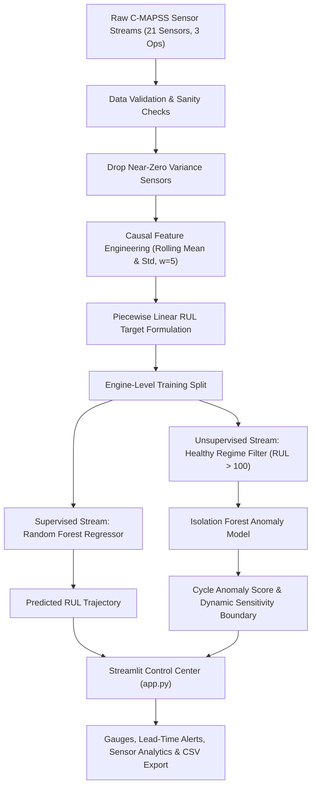

# ⚙ NASA Turbofan Predictive Maintenance AI

[](https://www.python.org/)
[](https://streamlit.io/)
[](https://scikit-learn.org/)
[](https://plotly.com/)
[](https://github.com/Vedant04-tech/nasa-turbofan-predictive-maintenance-ai/actions)
[](LICENSE)

> **Industrial Prognostics & Health Management (PHM)**: A modular machine learning system combining **supervised Remaining Useful Life (RUL) regression** and **unsupervised Isolation Forest anomaly intelligence**, served via an interactive **Streamlit Control Center**.

---

## 📌 Problem Statement & Objectives

In safety-critical aerospace and industrial rotating machinery, unplanned failures cause severe operational disruption, emergency repair costs, and safety risks. Conversely, rigid calendar-based maintenance schedules often replace healthy components prematurely.

This project implements a predictive maintenance system on multivariate turbofan engine sensor telemetry to:
1. **Estimate Remaining Useful Life (RUL)**: Accurately forecast remaining operational cycles using ensemble regression.
2. **Detect Early Sensor Anomalies**: Identify subtle sensor drift away from baseline nominal behavior before catastrophic breakdown.
3. **Calculate Early Warning Lead Times**: Measure operational warning windows to support condition-based maintenance planning.
4. **Provide an Interactive Diagnostics Interface**: Enable maintenance engineers to explore fleet telemetry, inspect anomaly progressions, and test custom flight datasets.

---

## 🏛 System Architecture

The project is structured as a modular Python package (`turbofan_ai`) with decoupled data preparation, model inference, prognostic evaluation, and presentation layers:



---

## 📊 Dataset & Limitations

The system is trained and benchmarked on the canonical **NASA Commercial Modular Aero-Propulsion System Simulation (C-MAPSS)** dataset (`FD001`):
- **Simulation Conditions**: Sea-level single operational regime.
- **Fault Mode**: High-Pressure Compressor (HPC) degradation.
- **Fleet Size**: 100 turbofan engines simulated from nominal state to run-to-failure breakdown.
- **Sensor Channels**: 21 raw sensor measurements (temperatures, pressures, fan speeds, bypass ratios) and 3 operating settings.

### Dataset Limitations:
- **Simulation vs. Flight Reality**: C-MAPSS data is generated by thermodynamic simulation models; real-world engines experience external weather variability, fluctuating flight envelopes, and diverse maintenance histories.
- **Single Fault Mode (`FD001`)**: The model is trained on compressor degradation. Multimodal failures (e.g., turbine blade cracks or bearing failures in sub-datasets `FD002`–`FD004`) require multi-regime normalization.
- **Run-to-Failure vs. In-Service Censoring**: In `FD001`, each engine runs until catastrophic failure. Real industrial operating data is right-censored because maintenance teams overhaul engines before failure occurs.

---

## ⚙️ Feature Engineering & Target Formulation

1. **Variance Filtering**: Dropped 7 flat sensor channels with near-zero standard deviation across engine lifespans (`sensor_1`, `sensor_5`, `sensor_6`, `sensor_10`, `sensor_16`, `sensor_18`, `sensor_19`).
2. **Causal Rolling Statistics**: Computed backward-looking rolling mean and rolling standard deviation over a 5-cycle window ($w = 5$, `min_periods=1`) grouped strictly by engine ID (`id`). This guarantees:
   - **No Lookahead Leakage**: Only historical and current cycles are used for feature computation.
   - **No Cross-Engine Leakage**: Grouping by engine ID prevents statistics from bleeding across different engines.
   - **Full Cycle Coverage**: `min_periods=1` allows immediate inference from cycle 1 without dropping early records.
3. **Piecewise Linear RUL Target**: During early cycles, degradation is undetectable. The RUL target is capped at 125 cycles:
   $$\text{RUL}(t) = \min(\text{MaxCycle} - t, 125)$$
   This prevents regressor bias from fitting noise during healthy operating periods.
4. **Final Feature Schema**: 29 input features (14 informative sensors, 3 operating settings, 12 rolling statistics).

---

## 📈 Model Evaluation & Benchmarks

Models were evaluated on a held-out test split of engine units to assess generalization to unseen machinery:

| Model Architecture | Task | RMSE | MAE | Operational Role |
| :--- | :--- | :---: | :---: | :--- |
| **Linear Regression** (Baseline) | RUL Regression | 21.17 | 17.03 | Benchmark baseline; underfits nonlinear degradation stages |
| **Random Forest Regressor** (100 Trees) | RUL Regression | **17.90** | **12.85** | Production regressor; ~15% error reduction over baseline |
| **Isolation Forest** (Contamination = 5%) | Anomaly Detection | — | — | Unsupervised safety net trained strictly on nominal cycles ($RUL > 100$) |

### Prognostic Semantics & Lead-Time Nuances:
- **Run-to-Failure Datasets**: When evaluated on run-to-failure benchmarks, the lead time represents the number of cycles from the first anomaly trigger until functional breakdown (typically ~40–46 cycles prior to failure).
- **In-Service Data**: On right-censored operating machinery that has not yet failed, this interval represents the **observed monitoring duration since initial anomaly trigger**, rather than a guaranteed time-to-failure estimate.

---

## 📁 Repository Structure

```text
nasa-turbofan-predictive-maintenance-ai/
├── .github/
│   └── workflows/
│       └── ci.yml                # Multi-OS / multi-Python CI pipeline (lint + test)
├── data/
│   ├── raw/
│   │   └── train_FD001.txt       # Benchmark NASA C-MAPSS FD001 dataset
│   └── samples/
│       └── engine_samples.csv    # Canonical multi-engine sample dataset for dashboard demo
├── docs/
│   ├── Internship Project PPT.pdf   # Project presentation
│   └── Internship Project PPT.pptx
├── models/
│   ├── rul_model.pkl             # Trained Random Forest Regressor (tracked via Git LFS)
│   ├── anomaly_model.pkl         # Trained Isolation Forest Detector (tracked via Git LFS)
│   └── feature_cols.pkl          # Serialized feature column schema (29 features)
├── notebooks/
│   └── Anamoly_Detection.ipynb   # Exploratory analysis, feature engineering & model training
├── src/
│   └── turbofan_ai/              # Core production package
│       ├── __init__.py           # Package exports and version
│       ├── data.py               # Data validation, cleaning, and causal rolling features
│       ├── models.py             # Artifact deserialization, inference, and physical constraints
│       └── evaluation.py         # Prognostic metrics and lead-time calculations
├── tests/
│   ├── __init__.py
│   ├── conftest.py               # Shared test fixtures and synthetic data generators
│   ├── test_data.py              # Tests for schema validation, rolling features, inf/nan handling
│   ├── test_models.py            # Tests for artifact loading, RUL non-negativity, anomaly thresholds
│   ├── test_evaluation.py        # Tests for RMSE, MAE, R^2, and lead-time semantics
│   └── test_app.py               # Headless Streamlit AppTest suite (UI, sliders, error handling)
├── .gitattributes                # Git LFS tracking configuration for *.pkl files
├── .gitignore                    # Python, pytest, and OS ignore rules
├── app.py                        # Canonical Streamlit Control Center application
├── pyproject.toml                # PEP 517/518 build specification, ruff & pytest configuration
├── requirements.txt              # Core runtime dependencies
├── requirements-dev.txt          # Development, testing, and linting dependencies
├── LICENSE                       # MIT License
└── README.md                     # Comprehensive project documentation
```

---

## 🚀 Quick Start Guide

### 1. Prerequisites
- **Python**: Version 3.10, 3.11, or 3.12 recommended.
- **Git & Git LFS**: Ensure Git Large File Storage is installed ([git-lfs.github.com](https://git-lfs.github.com/)).

### 2. Clone the Repository & Pull Model Artifacts
```bash
git clone https://github.com/Vedant04-tech/nasa-turbofan-predictive-maintenance-ai.git
cd nasa-turbofan-predictive-maintenance-ai

# Initialize Git LFS and download serialized model files
git lfs install
git lfs pull
```

### 3. Set Up Virtual Environment
```bash
# On Linux / macOS:
python3 -m venv .venv
source .venv/bin/activate

# On Windows (PowerShell):
python -m venv .venv
.venv\Scripts\Activate.ps1
```

### 4. Install Dependencies
```bash
# Production runtime:
pip install -r requirements.txt

# Development and testing tools:
pip install -r requirements-dev.txt

# (Optional) Install the turbofan_ai package in editable mode:
pip install -e .
```

### 5. Launch the Dashboard
```bash
streamlit run app.py
```

1. Open your browser at `http://localhost:8501`.
2. Choose **"Load Benchmark Sample Dataset"** for instant demonstration or **"Upload Custom CSV"** to test your own data.
3. Select an Engine Unit ID and interactively adjust the **Anomaly Sensitivity Threshold** slider to evaluate risk shifts.

---

## 🧪 Testing & Code Quality

The project includes 23 automated tests covering data validation, artifact integrity, physical regression bounds, prognostic lead times, and interactive Streamlit UI components:

```bash
# Run full pytest suite
pytest tests/ -v

# Run with test coverage report
pytest tests/ --cov=turbofan_ai --cov-report=term-missing

# Run code style & linting checks
ruff check .
```


---

## 🔒 Known Limitations & Future Work

1. **Deep Learning Sequence Modeling**: Replacing flat rolling features with temporal deep learning architectures (e.g., Temporal Convolutional Networks [TCN] or BiLSTM/Transformers) to learn degradation trajectories over varying sequence lengths.
2. **Multi-Condition Normalization**: Extending preprocessing pipelines to C-MAPSS sub-datasets `FD002` and `FD004` that feature 6 operating conditions and multiple failure modes.
3. **Uncertainty Quantification**: Incorporating Conformal Prediction or Quantile Regression Forests to output calibrated confidence bounds around RUL predictions ($RUL \pm \delta$) for safety-critical maintenance decisions.
4. **API Serving**: Exposing FastAPI endpoints with OpenAPI specifications for headless microservice deployment in Kubernetes environments.

---

## 📄 License & Credits

- **License**: Released under the [MIT License](LICENSE).
- **Author**: Vedant Bhaskar Porje
- **Dataset Source**: NASA Ames Prognostics Center of Excellence (PCoE) Turbofan Engine Degradation Simulation Dataset.
