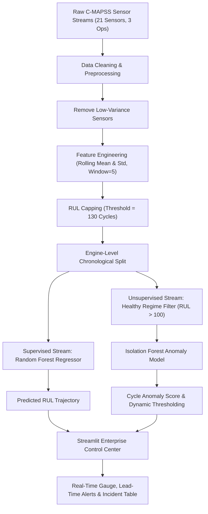

# ⚙ NASA Turbofan Predictive Maintenance AI: RUL & Anomaly Forecasting

[](https://www.python.org/)
[](https://streamlit.io/)
[](https://scikit-learn.org/)
[](https://plotly.com/)
[](LICENSE)
[]()

> **Real-Time Degradation Monitoring • Failure Forecasting • Anomaly Intelligence**  
> An industrial AI/ML solution combining **supervised Remaining Useful Life (RUL) regression** and **unsupervised Isolation Forest anomaly detection** deployed through an interactive **Streamlit Enterprise Control Center**.

---

## 📌 Executive Overview

Unplanned equipment downtime and catastrophic rotating machinery breakdowns incur significant financial and operational losses across aerospace, manufacturing, and heavy industry. Traditional maintenance paradigms—reactive breakdown repair and rigid calendar-based inspections—are either too late or needlessly expensive.

This system leverages multivariate sensor streams to provide an end-to-end predictive health monitoring platform:
- **Remaining Useful Life (RUL) Estimation**: Forecasts the remaining cycles until failure using an ensemble **Random Forest Regressor**.
- **Anomaly Detection & Outlier Profiling**: Detects early deviation from normal operation using an **Isolation Forest** trained strictly on healthy operating regimes ($RUL > 100$).
- **Dynamic Sensitivity Tuning**: An interactive threshold slider links risk indicators, gauge meters, and early warning lead time calculations in real-time.
- **Early Warning Lead Time**: Consistently detects emerging degradation patterns **~40–46 cycles prior to breakdown**, empowering maintenance teams to plan part replacements proactively.

---

## 🏛 System Architecture

The solution uses a **dual-model framework** designed to prevent data leakage and decouple normal behavior from degradation stages:



---

## 📊 Dataset & Feature Engineering Strategy

The platform is built on the benchmark **NASA Commercial Modular Aero-Propulsion System Simulation (C-MAPSS)** turbofan degradation dataset (`FD001`):
- **100 Turbofan Engines** tracked across continuous operational flights until system failure.
- **21 Sensor Signals** measuring temperatures, pressures, fan speeds, bypass ratios, and bleed fractions.
- **3 Operational Setting Variables** reflecting throttle and flight condition parameters.

### Engineering Pipeline:
1. **Variance Filtering**: Dropped flat sensors with near-zero variance across operating lifespans.
2. **Degradation Feature Extraction**: Computed **rolling means** and **rolling standard deviations** ($window = 5$) grouped per engine (`id`) to preserve physical causality and eliminate group leakage.
3. **RUL Target Formulation**: Formulated piecewise linear remaining useful life, capped at **130 cycles** (`RUL_CAP = 130`) to model constant healthy initial wear before nonlinear degradation initiates.

---

## 📈 Model Performance & Evaluation

| Model Architecture | Task | RMSE | MAE | Notes |
| :--- | :--- | :---: | :---: | :--- |
| **Linear Regression** (Baseline) | RUL Regression | 21.17 | 17.03 | Underfits nonlinear wear stages |
| **Random Forest Regressor** (Production) | RUL Regression | **17.90** | **12.85** | **~15% lower RMSE**, captures nonlinear degradation |
| **Isolation Forest** | Anomaly Intelligence | Contamination = 5% | — | Trained exclusively on healthy cycles ($RUL > 100$) |

### Key Operational Milestones:
- **Prediction Accuracy**: Random Forest regressor closely tracks actual degradation along the diagonal axis.
- **Early Warning Lead Time**: First anomaly flags consistently occur **~40 cycles before failure**, providing optimal lead time for maintenance dispatch.

---

## 🖥 Streamlit Enterprise Control Center

The dashboard ([Ai_Maintainence_Predictor.py](file:///c:/Users/Admin/Desktop/Internship%20Project/Ai_Maintainence_Predictor.py)) features:
- **Executive Metric Cards**: Real-time display of Predicted RUL, Current Anomaly Score, Early Warning Lead Time, and System Health Status.
- **Anomaly Risk Meter (Plotly Gauge)**: Live visual indicator dynamically highlighted in red/green based on the active sensitivity threshold.
- **Degradation Trend Graphs**: Interactive time-series comparing RUL degradation and anomaly progression curves.
- **Sensitivity Threshold Slider**: Live slider ($-0.5$ to $+0.5$) with instantaneous cache-accelerated re-evaluation of anomaly events and lead time.
- **Detected Anomaly Audit Table**: Detailed cycle-by-cycle breakdown of flagged anomaly timestamps.

---

## 📁 Repository Structure

```text
├── .gitattributes                # Git LFS configuration for large model files (*.pkl)
├── .gitignore                    # Git exclusions (virtualenvs, caches, temporary files)
├── Ai_Maintainence_Predictor.py  # Streamlit Production Application & Control Center
├── requirements.txt              # Core runtime dependencies
├── test_predictor.py             # Pytest automated test suite & Streamlit AppTests
├── engine_samples.csv            # Clean sample engine dataset for instant demo
├── #engine_samples.csv           # Benchmark engine dataset
├── rul_model.pkl                 # Pre-trained Random Forest Regressor (tracked via LFS)
├── anomaly_model.pkl             # Pre-trained Isolation Forest Model (tracked via LFS)
├── feature_cols.pkl              # Serialized feature column specification
├── Supported Files/
│   ├── Anamoly_Detection.ipynb   # Model training, exploratory analysis & experiments
│   ├── train_FD001.txt           # NASA C-MAPSS raw training data
│   ├── Internship Project PPT.pdf# Executive presentation document
│   └── Internship Project PPT.pptx
└── README.md                     # Project documentation
```

---

## 🚀 Quick Start Guide

### 1. Prerequisites
- **Python 3.10+**
- **Git** with **Git LFS** installed ([git-lfs.com](https://git-lfs.github.com/))

### 2. Clone the Repository & Pull Models
```bash
git clone https://github.com/<your-username>/nasa-turbofan-predictive-maintenance-ai.git
cd nasa-turbofan-predictive-maintenance-ai

# Pull model weights tracked by Git LFS
git lfs install
git lfs pull
```

### 3. Set Up Virtual Environment
```bash
# Create virtual environment
python -m venv .venv

# Activate on Windows (PowerShell):
.venv\Scripts\Activate.ps1
# Or on macOS/Linux:
source .venv/bin/activate
```

### 4. Install Dependencies
```bash
pip install -r requirements.txt
```

### 5. Launch the Dashboard
```bash
streamlit run Ai_Maintainence_Predictor.py
```
1. Open the local URL displayed in your terminal (typically `http://localhost:8501`).
2. In the sidebar, click **"Upload Engine Dataset"** and select `engine_samples.csv`.
3. Select an engine ID from the dropdown and interactively tune the **Anomaly Sensitivity Threshold**.

---

## 🧪 Automated Testing

The project includes an automated test suite verifying model deserialization, feature schema integrity, mathematical threshold reactivity, and headless Streamlit AppTest UI validation:

```bash
# Run pytest verification suite
pytest test_predictor.py -v
```

Output:
```text
test_predictor.py::test_models_exist_and_loadable PASSED                 [ 25%]
test_predictor.py::test_dataset_and_feature_columns_match PASSED         [ 50%]
test_predictor.py::test_threshold_reactivity_logic PASSED                [ 75%]
test_predictor.py::test_app_test_slider_reactivity PASSED                [100%]
======================= 4 passed in 25s =======================
```

---

## 🎓 Academic Credits & Acknowledgements

- **Developer**: Vedant Bhaskar Porje
- **Department**: Department of Computer Engineering
- **Institution**: PES Modern College of Engineering, Savitribai Phule Pune University (SPPU)
- **Academic Guidance**: Prof. Mrs. Mayuri A. Khade
- **Benchmark Dataset**: NASA Prognostics Data Repository (C-MAPSS Turbofan Simulation)
